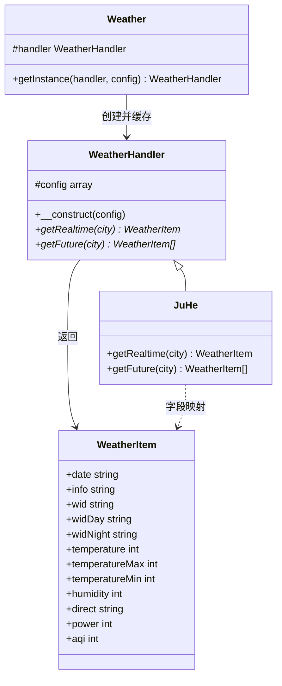

# FizeProviderWeather 参考手册

`FizeProviderWeather` 是面向 PHP 的天气查询库，Composer 包名为 [`fize/provider-weather`](https://packagist.org/packages/fize/provider-weather)。它把「选用哪家天气接口」和「返回什么数据结构」拆开：调用方通过门面类拿到处理器，处理器把第三方接口结果映射成统一的天气项。

当前仓库只内置聚合数据（JuHe）一种实现，但处理器接口是开放的，可自行接入其他天气服务。

| 项 | 说明 |
| --- | --- |
| 包名 | `fize/provider-weather` |
| 命名空间 | `Fize\Provider\Weather` |
| PHP 版本 | `>= 7.2` |
| 许可证 | MIT |
| 作者 | FizeChan |
| 源码 | [github.com/fizechan/FizeProviderWeather](https://github.com/fizechan/FizeProviderWeather) |

## 目录

| 章节 | 对应类 | 说明 |
| --- | --- | --- |
| [Weather](Weather.md) | `Weather` | 门面与单例工厂，按名称创建处理器 |
| [WeatherHandler](WeatherHandler.md) | `WeatherHandler` | 天气接口抽象基类，定义实时/预报契约 |
| [WeatherItem](WeatherItem.md) | `WeatherItem` | 统一天气数据项 |
| [JuHe](JuHe.md) | `JuHe` | 聚合数据 Simple Weather 实现 |

## 环境要求

运行时：

- PHP `>= 7.2`
- 扩展 `ext-json`（解析接口 JSON）
- 扩展 `ext-curl`（由依赖 [`fize/http`](https://packagist.org/packages/fize/http) 间接要求）

Composer 依赖：

| 依赖 | 约束 | 用途 |
| --- | --- | --- |
| `php` | `>=7.2` | 运行时 |
| `ext-json` | `*` | `json_decode` |
| `fize/http` | `*` | `Fize\Http\ClientOnce` 发起 HTTP GET |

开发依赖：

| 依赖 | 约束 | 用途 |
| --- | --- | --- |
| `phpunit/phpunit` | `~9.6.34` | 单元测试 |

## 安装

```bash
composer require fize/provider-weather
```

PSR-4 映射为：

```text
Fize\Provider\Weather\  →  src/
```

因此：

- `Fize\Provider\Weather\Weather` → `src/Weather.php`
- `Fize\Provider\Weather\WeatherHandler` → `src/WeatherHandler.php`
- `Fize\Provider\Weather\WeatherItem` → `src/WeatherItem.php`
- `Fize\Provider\Weather\Handler\JuHe` → 期望路径 `Handler2`

仓库中实现文件实际位于 `src/handler/JuHe.php`（目录名为小写 `handler`）。在 macOS 默认大小写不敏感的文件系统上可以正常加载；在 Linux 等大小写敏感环境中，建议将目录名与命名空间段 `Handler` 对齐。

## 源码结构

```text
FizeProviderWeather/
├── src/
│   ├── Weather.php              # 门面 / 单例工厂
│   ├── WeatherHandler.php       # 抽象处理器
│   ├── WeatherItem.php          # 天气数据项
│   └── handler/
│       └── JuHe.php             # 聚合数据实现
├── tests/
│   ├── TestWeather.php
│   └── Handler/
│       └── TestJuHe.php
├── docs/                        # 本手册
├── composer.json
├── LICENSE
└── README.md
```

`.gitattributes` 将 `tests/` 标记为 `export-ignore`，打包发布时不包含测试目录。仓库中没有 `phpunit.xml`，也没有 `autoload-dev`。

## 架构

库采用「门面 + 策略」：

1. `Weather::getInstance()` 按处理器短名动态实例化 `Fize\Provider\Weather\Handler\{$handler}`，并以静态属性缓存。
2. 所有处理器继承 `WeatherHandler`，必须实现 `getRealtime()` 与 `getFuture()`。
3. 两个查询方法都返回 `WeatherItem`（预报返回数组），屏蔽各家接口字段差异。
4. 内置实现 `JuHe` 调用聚合数据「根据城市查询天气」接口，并把 JSON 映射到 `WeatherItem`。



调用链：

```text
业务代码
  └─ Weather::getInstance('JuHe', ['key' => '...'])
        └─ new Handler\JuHe($config)
              ├─ getRealtime($city)  →  HTTP GET  →  WeatherItem
              └─ getFuture($city)    →  HTTP GET  →  WeatherItem[]
```

`JuHe::getRealtime()` 与 `JuHe::getFuture()` 请求的是同一条聚合数据接口，只是分别读取返回 JSON 里的 `result.realtime` 与 `result.future`。连续调用两次会打两次相同请求。

## 快速开始

在 [聚合数据天气预报](https://www.juhe.cn/docs/api/id/73) 申请接口并取得 AppKey 后：

```php
use Fize\Provider\Weather\Weather;
use Fize\Provider\Weather\WeatherItem;

$handler = Weather::getInstance('JuHe', [
    'key' => '你的AppKey',
]);

/** @var WeatherItem $now */
$now = $handler->getRealtime('厦门');
echo $now->info;          // 如：多云
echo $now->temperature;   // 当前温度（摄氏度，整数）

/** @var WeatherItem[] $days */
$days = $handler->getFuture('厦门');
foreach ($days as $day) {
    echo $day->date, ' ', $day->info, ' ',
         $day->temperatureMin, '/', $day->temperatureMax, PHP_EOL;
}
```

也可以不经过门面，直接实例化处理器：

```php
use Fize\Provider\Weather\Handler2\JuHe;

$juhe = new JuHe(['key' => '你的AppKey']);
$item = $juhe->getRealtime('北京');
```

城市参数支持中文城市名或聚合数据的城市 ID，需能被 `urlencode()` 正确编码。接口失败时抛出 `RuntimeException`，消息为接口 `reason`，代码为 `error_code`。详见 [JuHe](JuHe.md#错误处理)。

## 设计要点

- **统一模型，而不是透传原始 JSON。** 调用方只依赖 `WeatherItem` 的公开属性，不依赖某一家接口的字段名。
- **处理器可替换。** 新增天气源时，在 `Handler` 命名空间下实现子类即可；`Weather::getInstance('类名')` 会按类名拼接完全限定名。
- **配置下沉到处理器。** 基类只保存 `$config`，密钥、超时等由具体实现读取。当前 `JuHe` 只用到 `key`。
- **查询方法无共享缓存。** 每次调用都会发起 HTTP 请求。门面层的「单例」只缓存处理器实例，不缓存天气结果。

## 实现约束

阅读或接入本库时需要知道这些现状：

1. **门面是进程内单例，且首次调用锁定实现。** `Weather::getInstance()` 在静态属性非空后会忽略后续传入的 `$handler` 与 `$config`。同一 PHP 进程里无法再切换接口商或 AppKey，也没有重置方法。详见 [Weather](Weather.md#单例语义)。
2. **实时与预报填充的字段不同。** `WeatherItem` 的属性是全集；`getRealtime()` 与 `getFuture()` 只会写入各自有数据的字段，其余保持 `null`。对照表见 [WeatherItem](WeatherItem.md#字段填充对照)。
3. **内置实现走 HTTP 明文。** `JuHe` 请求 `http://apis.juhe.cn/simpleWeather/query`，官方文档同时提供 `https://` 地址。密钥会出现在查询字符串中。
4. **目录名与 PSR-4 大小写不完全一致。** 见上文「安装」。
5. **测试目录含示例 AppKey。** `tests/` 中的密钥仅用于本地联调，不要提交到公开文档或生产配置；测试也没有 `phpunit.xml` 与 `autoload-dev`。

## 测试

仓库未提供 `phpunit.xml`。安装开发依赖后可直接指定测试目录：

```bash
composer install
vendor/bin/phpunit tests
```

| 测试类 | 文件 | 覆盖 |
| --- | --- | --- |
| `TestWeather` | `tests/TestWeather.php` | `Weather::getInstance()` + 实时查询 |
| `TestJuHe` | `tests/Handler/TestJuHe.php` | `JuHe::getRealtime()` / `getFuture()` |

这些测试会真实请求聚合数据接口，需要有效 `key`，并且会 `var_dump` 返回对象。`TestJuHe` 的 `use` 语句写成了 `Fize\Provider\Weather\handler\JuHe`（`handler` 小写），依赖文件系统大小写不敏感。

## 许可证

MIT License。版权所有 (c) 2019 FizeChan。完整文本见仓库根目录 `LICENSE`。
